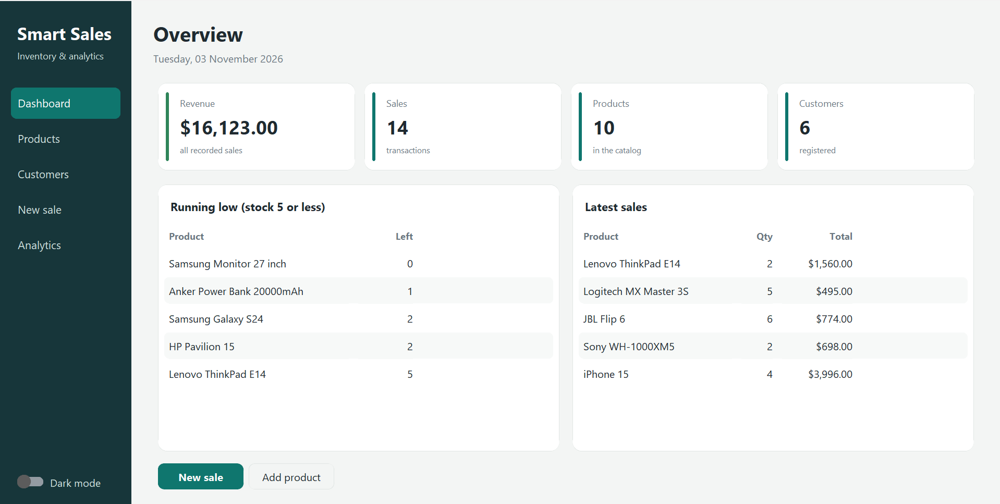
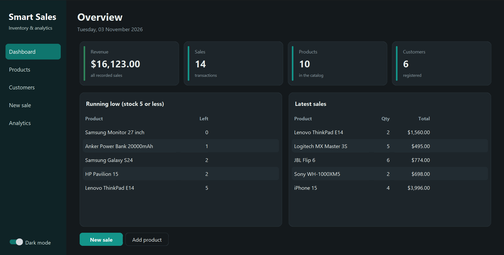
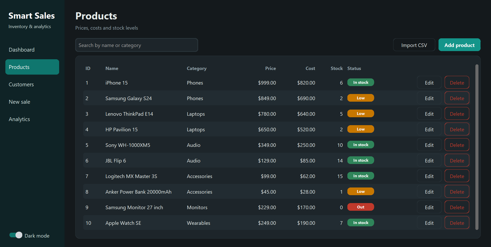
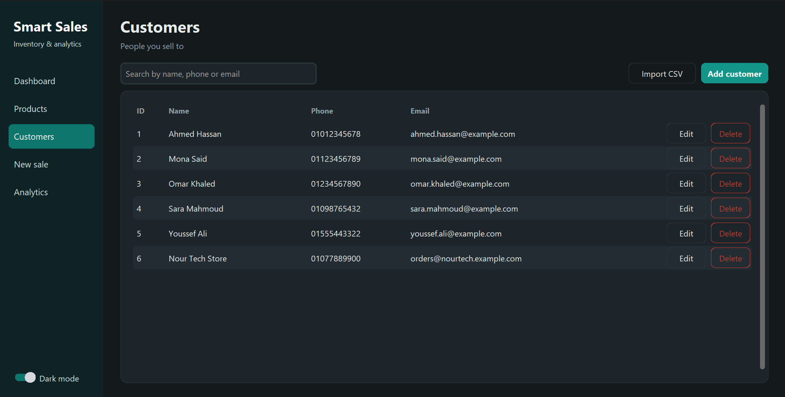
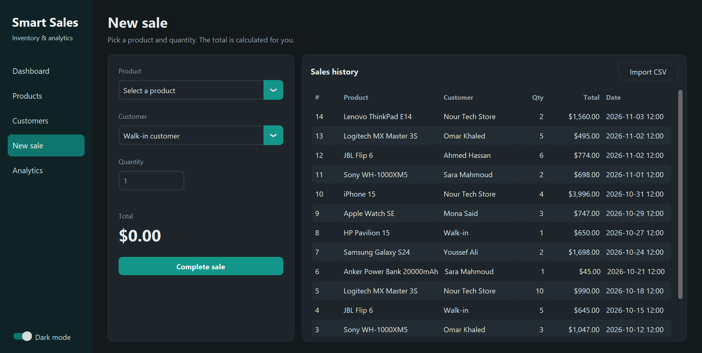
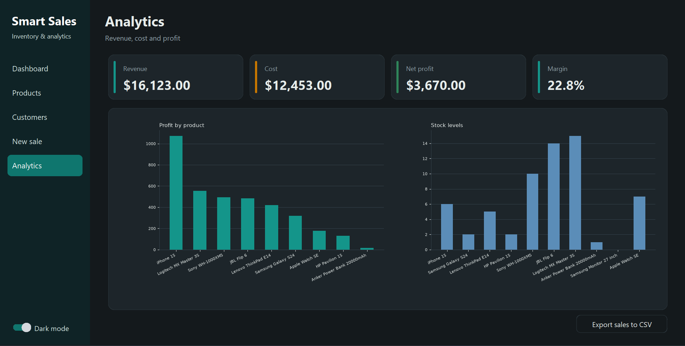
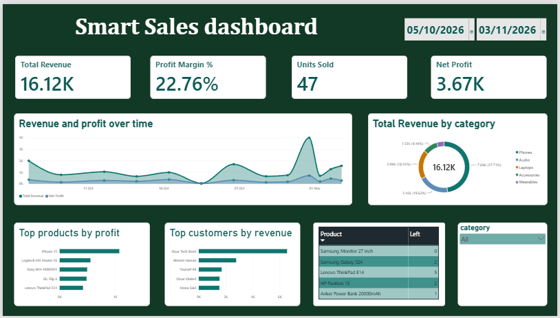

# Smart Sales Analytics App

A desktop application for managing **sales, inventory and customers**, with financial analytics and a connected **Power BI dashboard**. Built with Python, SQLite and CustomTkinter.



## Features

- **Products**: add, edit, delete, search; low-stock status badges
- **Customers**: add, edit, delete, search, email validation
- **Sales**: pick a product and customer, the total is calculated automatically and stock is deducted in the same transaction (no overselling)
- **Analytics**: revenue, cost, net profit and margin, charts, export to CSV
- **CSV import** for products, customers and sales
- **Light and dark mode**
- **Power BI dashboard** connected to the same SQLite database through ODBC

## Screenshots

### Light and dark mode

| Light | Dark |
|---|---|
|  |  |

### Products and customers





### Sales and analytics





## Power BI dashboard



The file `powerbi/Smart_Sales_Dashboard.pbix` contains the dashboard: revenue, profit, margin and units sold, revenue and profit over time, revenue by category, top products and customers, and a low-stock table.

Open it with **Power BI Desktop** (free, Windows). It shows the data saved at the last refresh, so no database is needed to view it.

To refresh it against your own database:

1. Install the **SQLite ODBC Driver (64-bit)**.
2. Open **ODBC Data Sources (64-bit)**, then **User DSN**, and add a SQLite3 data source named `SmartSales` that points to `database/sales_inventory.db`.
3. In Power BI Desktop, press **Home, then Refresh**.

## Tech stack

Python 3.10+, SQLite, CustomTkinter, Matplotlib, Power BI Desktop (via the SQLite ODBC driver).

## Getting started

```powershell
git clone https://github.com/Faisal-Pro/Smart_Sales_Analytics_App.git
cd Smart_Sales_Analytics_App
python -m venv venv
.\venv\Scripts\Activate.ps1
python -m pip install -r requirements.txt
python main.py
```

The database is created automatically on first run.

### Load the sample data

Import the files in `sample_data/` from inside the app, **in this order**, each once:

1. Products, then **Import CSV**: `products.csv`
2. Customers, then **Import CSV**: `customers.csv`
3. New sale, then **Import CSV**: `sales.csv`

Expected result: 10 products, 6 customers, 14 sales, revenue of $16,123.

### Run the tests

```powershell
python test_app.py
```

Tests use a temporary database and never touch your data.

## Project structure

```
Smart_Sales_Analytics_App/
├── main.py              # entry point
├── config.py            # settings (paths, theme, low-stock threshold)
├── db_manager.py        # connection handling and schema
├── database/
│   └── db_operations.py # all queries, validation and CSV import
├── gui/
│   ├── app.py           # screens
│   └── theme.py         # colors, fonts, reusable widgets
├── sample_data/         # CSV files for a quick demo
├── powerbi/             # Power BI dashboard (.pbix)
├── docs/                # screenshots used in this README
└── test_app.py
```

## Design notes

- Foreign keys are enforced, and money and stock are validated both in code and in the database schema.
- Each sale stores the product's cost at the time of sale, so historical profit stays correct if costs change later.
- A product or customer with recorded sales cannot be deleted.
